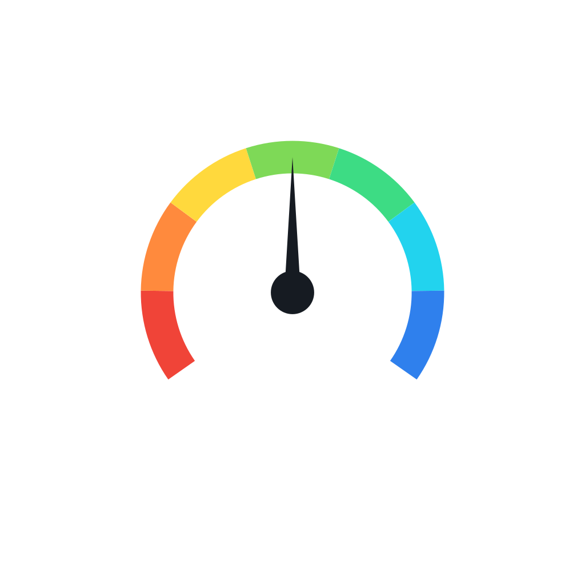

# Speed Meter

  

Speed Meter is an Android app that shows your phone's current network speed, download and upload, in your status bar. You can see your speed at a glance while you use other apps.

---

## What Can You Do With This App?

### ✅ Available Right Now

**Live network speed**
- **Status bar indicator.** A small icon in your status bar shows your total network speed, updated every second.
- **Download and upload.** The notification shows your download and upload speeds separately.
- **Easy-to-read units.** Speeds show in **KB/s**, and switch to **MB/s** once they pass 1,024 KB/s.
- **Runs in the background.** The indicator keeps working while you use other apps.
- **Quiet notification.** It makes no sound and does not vibrate. It stays on your device only.

**Home screen**
- **Enable indicator switch.** Turn the status bar indicator on or off. Your choice is saved on your phone.

**More screen**
- **Notification settings.** Opens your phone's notification settings for Speed Meter, so you can manage the indicator notification.
- **Dark theme switch.** Switch between light and dark appearance, independent of your phone's setting.
- **Help & feedback.** Choose **Suggest a feature** or **Report a bug**. Either option opens your email app with a message ready to send to the developer. Bug reports include your app version, phone model and Android version.
- **About.** Shows the app name, version and a short description.

**Layout and navigation**
- **Phones.** The screen shows one page at a time. Use the floating toolbar at the bottom to switch between **Home** and **More**. The toolbar hides as you scroll down and returns when you scroll up.
- **Tablets, foldables and large screens.** Home and More appear side by side, and the bottom toolbar is hidden.
- **Rotation and resizing.** The layout adjusts when you rotate your device or resize the window.
- **Title bar.** The top of the screen shows "Speed Meter" and stays in place as you scroll.
- **Keyboard-friendly.** The layout adjusts when the on-screen keyboard appears.

**Look and feel**
- **Light and dark mode.** The app follows your phone's system setting until you change it on the More screen.
- **Wallpaper colours (Android 12 and newer).** On supported phones, the app picks its colours from your wallpaper.
- **Full-screen display.** Content runs edge to edge behind the status bar and navigation bar.
- **Matching system bars.** The status bar and navigation bar icons switch between light and dark to suit the theme.
- **Speedometer app icon.** The icon shows a coloured gauge with a needle.
- **Themed icon (Android 13 and newer).** A single-colour icon matches your launcher's theme.
- **Smoother launch.** The app opens without a blank preview screen.

**Permissions**
- **Notifications (Android 13 and newer).** The app asks for permission to show notifications when you open it. The indicator needs this permission. If you deny it, the indicator will not appear until you allow it in your phone's settings.
- **Internet and network status.** Used to read your network speed. The app does not send your data anywhere.

---

## Known Issue

- **Indicator may restart after you turn it off.** If you turn the indicator off and later open Speed Meter, the indicator may start again even though the switch shows off. A fix is planned.

---

## Planned Features (Not Available Yet)

- **Daily data usage.** Track mobile data and Wi-Fi usage for each day.
- **Speed history.** Review past speeds.
- **Speedometer gauge.** A live gauge on the main screen that shows your speed.
- **Units setting.** Choose units such as KB/s, MB/s, km/h or mph.

---

## How to Install

1. Download the APK file for your device from the project's Releases page.
2. On your Android phone, go to **Settings → Install Unknown Apps** and allow installation from your browser or file manager.
3. Open the downloaded APK and tap **Install**.
4. Open **Speed Meter**. If asked, allow notifications so the indicator can appear.

---

## Requirements

- Android **8.0 (Oreo)** or higher
- Works on phones, tablets and foldables

---

## For Developers

- Kotlin with Jetpack Compose and Material 3
- Background service with live speed readings from Android's TrafficStats
- See `CHANGELOG.txt` for the full tech stack and feature history

---

## Support

Have a problem or an idea?
Use **More → Help & feedback** in the app, or reach out at **sdcgroupofficial@gmail.com**

---

## Made With ❤️ from India
